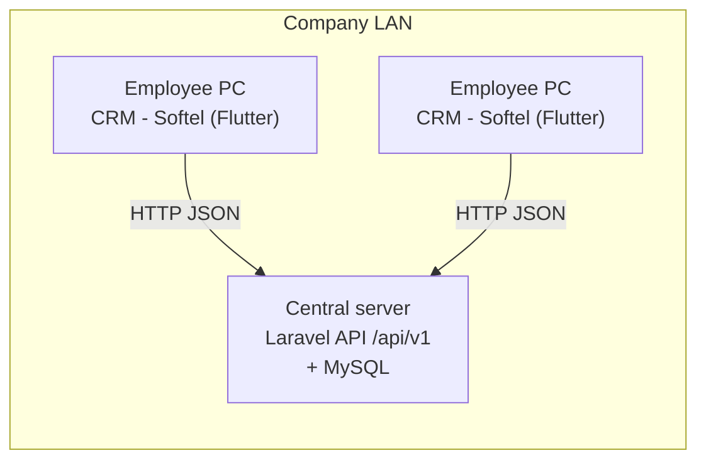
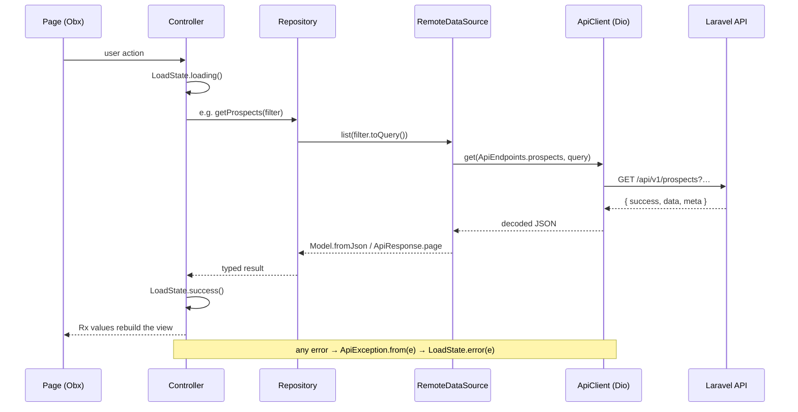
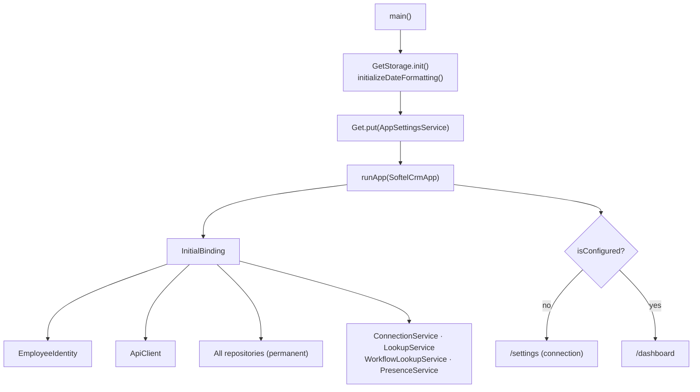
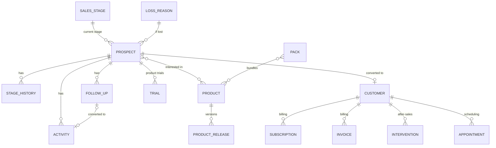

# Architecture

This document describes how the CRM - Softel desktop client is put together.
For setup and usage, see the [README](README.md).

## 1. System context



- The **backend** (separate Laravel project) owns all data, validation and
  business rules: stage transitions, follow-up states, billing, and so on.
- The **client** in this repository is a typed presentation layer. It holds no
  business data locally. Only preferences are persisted, with `get_storage`.
- There is **no user authentication**. Workstations are identified by Windows
  user and machine name (see [§7](#7-identity-presence-and-auditing)).

## 2. Code layout

```text
lib/
├── main.dart          bootstrap
├── app/               application layer (cross-feature)
│   ├── app.dart       GetMaterialApp: theme, locales, routes, initial route
│   ├── bindings/      InitialBinding: global DI graph
│   ├── config/        AppConfig defaults, AppSettingsService, KeyValueStore
│   ├── l10n/          `tr` accessor, supported locales
│   ├── routes/        route names + GetPage table
│   ├── services/      Connection, Lookup, WorkflowLookup, Presence, EmployeeIdentity
│   ├── shell/         desktop shell: sidebar, top bar, language menu, settings nav
│   └── theme/         light/dark ThemeData built from design tokens
├── core/              framework-level building blocks, no feature knowledge
│   ├── network/       ApiClient, ApiEndpoints, interceptors, ApiResponse, ApiException
│   ├── state/         LoadState, ActionResult
│   ├── models/        NamedRef
│   ├── utils/         formatters, validators, debouncer, json utils, WhatsApp launcher
│   └── widgets/       data table, filters, forms, charts, shimmer, state views…
└── features/<name>/
    ├── data/          models (fromJson/toJson), remote data source, repository impl
    ├── domain/        abstract repository (the contract controllers depend on)
    └── presentation/  binding, controllers, pages, widgets, dialogs
```

Feature modules: `activities`, `analytics`, `billing`, `customers`,
`dashboard`, `employees`, `follow_ups`, `interventions`, `pipeline`,
`products`, `prospects`, `releases`, `scheduling`, `settings`,
`workflow_settings`. A few small modules skip a layer: `pipeline` reuses the
prospects repository, and `employees` has its repository in `data/` only.

## 3. Request flow



### Networking (`lib/core/network`)

- **`ApiClient`** wraps Dio. `configure()` changes the base URL and timeout at
  runtime. `InitialBinding` calls it through `ever(...)` whenever the settings
  change, so no restart is needed. Upload and download helpers report progress.
- **Interceptors**, in order:
  1. `JsonHeadersInterceptor` sets `Accept: application/json`, so Laravel
     answers errors as JSON.
  2. `EmployeeHeaderInterceptor` adds `X-Employee-Name` on non-GET requests.
  3. `JsonResponseGuardInterceptor` rejects 2xx responses that are not JSON,
     for example a web-server welcome page behind a wrong URL.
  4. `DebugLogInterceptor` logs requests in debug builds only.
- **`ApiResponse`** unwraps the `{ success, message, data, meta }` envelope and
  pagination.
- **`ApiException`** is a sealed hierarchy (network, timeout, cancelled,
  validation, server, unknown…). Messages are already localized, so
  controllers can show `e.message` directly. Validation errors (`422`)
  carry per-field messages for forms.
- **`ApiEndpoints`** is the single list of every path the client calls.

### State (`lib/core/state`)

- **`LoadState`** holds observable `initial / loading / success / error` state,
  the last error, and `isConnectionError` so views can show a "server
  unreachable" state instead of a generic error.
- **`ActionResult`** is the success/failure result of one-off commands (save,
  delete, change stage) that dialogs use to show feedback.

## 4. Dependency injection and lifecycle



- `AppSettingsService` is registered before `runApp` because the theme, locale,
  initial route and API address all depend on it.
- Repositories are **permanent singletons** because several features share
  them (the pipeline and the prospects list both use the prospects repository).
- Controllers are created by per-route **bindings** (`features/*/presentation/bindings`)
  and disposed with their route.
- Navigation (`app/shell/navigation.dart`): sidebar targets replace the stack
  (`offAllNamed`), detail pages are pushed. Re-opening the current page does
  nothing, which avoids GetX disposing a controller it just created.

## 5. Global services (`lib/app/services`)

| Service | Responsibility |
|---|---|
| `ConnectionService` | Polls `GET /health` every 60 s (5 s timeout) to drive the top-bar status, and sends the best-effort `POST /system/heartbeat`. |
| `LookupService` | Caches reference data (sales stages, loss reasons, products, packs, form options) for dropdowns and filters. |
| `WorkflowLookupService` | Caches the server-driven workflow configuration (`/config/{entity}`). |
| `PresenceService` | Reads and updates this workstation's presence (available / busy / away / break) optimistically, rolling back if the server refuses. |
| `EmployeeIdentity` | Derives `username@device` from the Windows environment. |

## 6. Domain overview

The client mirrors the backend's main entities. The authoritative schema and
migrations live in the Laravel project. Field-level mapping is in
[docs/API_CONTRACT.md](docs/API_CONTRACT.md).



A customer is a converted prospect. Billing endpoints are keyed by prospect id
(`/billing/customers/{prospectId}`, …).

## 7. Identity, presence and auditing

There is no login. Each workstation:

1. Computes `employeeId = "<windows user>@<computer name>"`, at most 50 characters.
2. Sends `X-Employee-Name: <windows user>` (ASCII only, at most 100
   characters) on every write request, so the server can record who did what.
3. Sends a heartbeat (`POST /system/heartbeat`) and reads or updates team presence
   through `/system/employees` and `/system/employees/presence`.

This is an **audit label, not a security boundary**. See [SECURITY.md](SECURITY.md).

## 8. Localization and theming

- ARB files in `lib/l10n/` (French is the template). Code is generated by
  `flutter gen-l10n` (`generate: true` in `pubspec.yaml`, settings in
  `l10n.yaml`).
- `tr` (from `app/l10n/l10n.dart`) gives non-widget code such as exceptions and
  controllers access to the current `AppLocalizations`. Changing language calls
  `Get.updateLocale` and rebuilds the whole tree without a restart.
- Arabic enables RTL layout and Arabic date formatting. Fonts (Quicksand,
  Alexandria) come from `google_fonts`.
- `app_theme.dart` builds both Material 3 themes from one set of design tokens.

## 9. Key decisions

| Decision | Rationale |
|---|---|
| Thin client, no local DB | One source of truth on the LAN server; avoids sync conflicts between workstations. |
| Server address configured at runtime | One installer works on any LAN; IT staff change the IP without rebuilding. |
| GetX for state, routing and DI | One lightweight dependency covering the three concerns for a desktop app. |
| Domain repository interfaces | Controllers are tested against fakes; data sources are tested with a mock Dio adapter. |
| Localized exceptions | Every error that reaches the UI is already user-readable in the current language. |
| Server-driven workflow config | Business options change without shipping a new client. |
