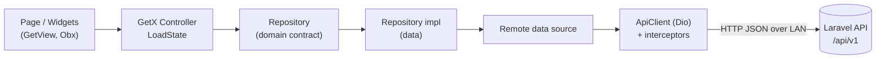

<p align="center">
  
</p>

<h1 align="center">CRM - Softel</h1>

<p align="center">
  <b>Windows desktop CRM client for SOFTEL's sales, customer-success and after-sales teams.</b><br/>
  Built with Flutter, talking to the SOFTEL Laravel REST API over the company LAN.
</p>

<p align="center">
  
  
  
  
  
</p>

---

## Contents

- [Overview](#overview)
- [Features](#features)
- [Screenshots](#screenshots)
- [Tech stack](#tech-stack)
- [Architecture](#architecture)
- [Project structure](#project-structure)
- [Getting started](#getting-started)
- [Configuration](#configuration)
- [Testing and code quality](#testing-and-code-quality)
- [Building and distributing](#building-and-distributing)
- [Localization](#localization)
- [Security notes](#security-notes)
- [Documentation](#documentation)
- [Contributing](#contributing)
- [License](#license)
- [Author](#author)

## Overview

**CRM - Softel** is the desktop workstation used by SOFTEL employees to follow a
customer through its whole life cycle: from the first contact as a prospect,
through the sales pipeline, trial and conversion, to billing, maintenance
renewals, after-sales interventions and product releases.

The app is a **thin, typed client**: all data and business rules live in the
SOFTEL Laravel backend (a separate project). The client runs on each
employee's Windows PC and connects to the central server's LAN address, which
is configured inside the app. There is no local database; only user
preferences (server address, timeout, theme, language) are stored locally.

## Features

Every module below is backed by a data source, repository, controller and page
in [`lib/features/`](lib/features/).

| Area | What it does |
|---|---|
| **Dashboard** | KPIs (total / open / won / lost prospects), breakdown by sales stage and by loss reason, today's and overdue follow-ups. |
| **Analytics** | Charts hub (built with `fl_chart`) fed by the `/analytics` endpoint. |
| **Prospects** | Paginated, filterable, sortable list with debounced search; detail page with stage history, activities, follow-ups and linked products; create / edit forms with configurable option lists. |
| **Pipeline** | Kanban board with drag-and-drop between sales stages, loss reason and note required when moving to *Lost*. |
| **Follow-ups** | Tabs for overdue / today / upcoming / completed / cancelled; complete with a result (optionally logged as an activity) or cancel with a reason. |
| **Activities** | Calls, meetings, messages and notes, linkable to a prospect or follow-up; "log activity and schedule next follow-up" flow. |
| **Customers** | Prospect-to-customer conversion, lifetime customer profile, product trials (activate / revoke), maintenance and support statistics. |
| **Scheduling** | Calendar, appointment booking and actions (including recurring series), training sessions and customer-portal requests. |
| **After-sales** | Intervention tickets with a chat-style timeline, attachments (upload, preview, download) and closure dialogs. |
| **Billing** | Cash-based subscriptions, per-customer invoices, maintenance renewal quotes, mark-as-paid and scanned receipts. |
| **Products** | Catalog with multilingual content, images and demo uploads; product packs with composition rules. |
| **Releases** | Product release versions with installer upload and download. |
| **Workstation** | Team presence (available / busy / …), heartbeat, and the employee identity used for auditing. |
| **Settings** | Server connection (URL, timeout, connection test), sales stages, loss reasons, prospect form options (drag-to-reorder), and server-driven workflow configuration with contextual help. |
| **UX** | French, English and Arabic with full right-to-left layout; light / dark / system theme; WhatsApp deep links from phone numbers; live server-status indicator in the top bar. |

## Screenshots

> No screenshots are committed yet. See [Recommended screenshots](#recommended-screenshots) below.

## Tech stack

| Concern | Choice |
|---|---|
| UI toolkit | [Flutter](https://flutter.dev) 3.47 (stable), Material 3 |
| Language | Dart 3.13 (`sdk: ^3.13.7`) |
| State, routing, DI | [`get`](https://pub.dev/packages/get) (GetX) |
| HTTP | [`dio`](https://pub.dev/packages/dio) with custom interceptors |
| Local preferences | [`get_storage`](https://pub.dev/packages/get_storage) |
| i18n | `flutter_localizations`, `intl`, ARB files (`flutter gen-l10n`) |
| Charts | [`fl_chart`](https://pub.dev/packages/fl_chart) |
| Icons and fonts | `hugeicons`, `font_awesome_flutter`, `google_fonts` (Quicksand, Alexandria) |
| Platform integration | `url_launcher`, `file_picker` |
| Installer | [Inno Setup](https://jrsoftware.org/isinfo.php) script in [`installer/`](installer/) |
| Backend (separate repo) | Laravel REST API, `/api/v1` |

## Architecture

Feature-first modules, each split into **data / domain / presentation** layers,
on top of a shared `core` (networking, state primitives, widgets) and an `app`
layer (routing, bindings, global services, shell).



See **[ARCHITECTURE.md](ARCHITECTURE.md)** for the layers, data flow, error
handling, startup sequence and design decisions.

## Project structure

```text
.
├── assets/branding/        App icon (PNG + SVG)
├── docs/                   API contract notes, deployment guide
├── installer/              Inno Setup script for the Windows installer
├── lib/
│   ├── app/                App layer: bindings, config, l10n helper, routes,
│   │                       global services, desktop shell, theme
│   ├── core/               Shared: network (Dio client, endpoints, errors),
│   │                       state (LoadState, ActionResult), utils, widgets
│   ├── features/<module>/  data/ (models, data sources, repo impl)
│   │                       domain/ (repository contracts)
│   │                       presentation/ (bindings, controllers, pages, widgets)
│   ├── l10n/               ARB files (fr = template, en, ar) + generated code
│   └── main.dart           Entry point
├── test/                   Unit, repository, controller and widget tests
├── tool/                   Python helper scripts (see tool/README.md)
└── windows/                Flutter Windows runner (CMake, resources)
```

## Getting started

### Prerequisites

- **Windows 10/11 x64**
- **Flutter SDK 3.47 (stable)** or newer compatible release, which includes Dart 3.13 — [install guide](https://docs.flutter.dev/get-started/install/windows/desktop)
- **Visual Studio 2022** with the *Desktop development with C++* workload
- **Git**
- A reachable instance of the **SOFTEL Laravel backend** (separate project)

Check your toolchain with `flutter doctor`.

### Install and run

```bash
git clone https://github.com/khaledbouhoun/CRM-Softel.git
cd CRM-Softel
flutter pub get          # also generates the localization classes (generate: true)
flutter run -d windows
```

On first launch the app opens **Settings → Connection**. Enter the server
address, press **Test connection**, then save.

## Configuration

There are **no `.env` files or build-time secrets**. Everything is configured at
runtime and stored per Windows user with `get_storage`:

| Setting | Default | Notes |
|---|---|---|
| API base URL | `http://192.168.1.100:8000/api/v1` | Must be the central server's LAN address, never `localhost` on employee PCs. |
| Request timeout | 15 s | Allowed range 3–120 s. |
| Theme | System | Light / dark / system. |
| Language | Arabic | Arabic, French, English. |

Defaults live in [`lib/app/config/app_config.dart`](lib/app/config/app_config.dart).
The connection test calls `GET /health`, which returns 503 when the server's
database is down. The top bar re-checks connectivity every 60 seconds.

Backend setup, database and migrations are handled by the Laravel project and
are **out of scope for this repository**. How the client maps the API is
documented in [docs/API_CONTRACT.md](docs/API_CONTRACT.md).

## Testing and code quality

```bash
flutter analyze          # lints from analysis_options.yaml (flutter_lints)
dart format lib test     # formatting
flutter test             # all tests under test/
```

The suite covers models (JSON mapping), repositories (through a mock Dio
adapter in [`test/helpers/mock_http_adapter.dart`](test/helpers/mock_http_adapter.dart)),
GetX controllers, bindings, localization and widgets. No network access or
running backend is needed.

## Building and distributing

```bash
flutter build windows --release
```

The output is in `build\windows\x64\runner\Release\`. To package it as a
per-user installer (`CRM-Softel-Setup.exe`), compile
[`installer/CRM-Softel.iss`](installer/CRM-Softel.iss) with Inno Setup.
Full steps and versioning are in **[docs/DEPLOYMENT.md](docs/DEPLOYMENT.md)**.

## Localization

Strings live in [`lib/l10n/`](lib/l10n/): `app_fr.arb` (template),
`app_en.arb` and `app_ar.arb`. After editing them, run `flutter gen-l10n`, or
just `flutter pub get` / `flutter run`. Arabic switches the whole UI to RTL.
The language can be changed at runtime from the top bar.

## Security notes

- The client has **no user login**: every workstation has the same access. The
  Windows user name is sent as `X-Employee-Name` on write requests. It is an
  audit label, not authentication.
- Traffic uses plain HTTP by default and is meant for a trusted company LAN.
- No credentials or API keys are stored in the client or in this repository.

See **[SECURITY.md](SECURITY.md)** for the trust model and how to report a vulnerability.

## Documentation

| Document | Purpose |
|---|---|
| [ARCHITECTURE.md](ARCHITECTURE.md) | Layers, data flow, services, decisions |
| [docs/API_CONTRACT.md](docs/API_CONTRACT.md) | How the client maps the backend API |
| [docs/DEPLOYMENT.md](docs/DEPLOYMENT.md) | Release build, installer, rollout to workstations |
| [CONTRIBUTING.md](CONTRIBUTING.md) | Workflow, conventions, pull requests |
| [SECURITY.md](SECURITY.md) | Security model and reporting |
| [CHANGELOG.md](CHANGELOG.md) | Notable changes |

## Contributing

Contributions follow the workflow in [CONTRIBUTING.md](CONTRIBUTING.md):
branches, Conventional Commits, and analyze, format and test before every pull request.

## License

Proprietary. All rights reserved by **SOFTEL**. No license file is included
yet, so no permission to copy, modify or redistribute is granted.

## Author

Developed by **[Khaled Bouhoun](https://github.com/khaledbouhoun)** for SOFTEL.

---

### Recommended screenshots

Capture at 1440×900 or larger, in light mode (plus one dark and one Arabic view),
and save them in `docs/screenshots/`:

| File | Screen |
|---|---|
| `dashboard.png` | Dashboard with KPIs and follow-ups |
| `pipeline.png` | Kanban pipeline mid-drag |
| `prospect-details.png` | Prospect page with stage history |
| `follow-ups.png` | Follow-up tabs |
| `customer-profile.png` | Customer profile |
| `calendar.png` | Scheduling calendar |
| `intervention.png` | After-sales ticket chat |
| `billing.png` | Billing / subscriptions |
| `analytics.png` | Analytics charts |
| `dark-mode.png` | Any main screen in dark theme |
| `arabic-rtl.png` | Any main screen in Arabic (RTL) |
