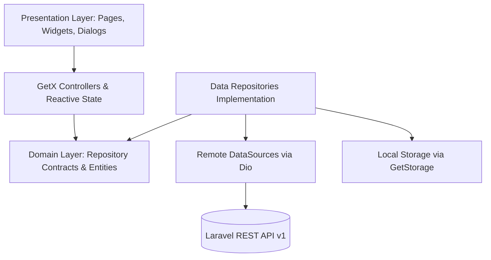

# 🏢 SOFTEL CRM — Enterprise Desktop Client

<p align="center">
  
  
  
  
  
  
  
</p>

<p align="center">
  <b>A modern, high-performance desktop CRM client built with Flutter and Dart, engineered for enterprise sales teams and seamlessly integrated with a powerful Laravel REST API.</b>
</p>

---

## 📖 Table of Contents

- [Overview](#-overview)
- [Key Features](#-key-features)
  - [📊 Dashboard & Analytics](#-dashboard--analytics)
  - [👥 360° Prospect Management](#-360-prospect-management)
  - [📌 Visual Kanban Pipeline](#-visual-kanban-pipeline)
  - [⏰ Follow-Ups & Task Scheduling](#-follow-ups--task-scheduling)
  - [📝 Activity & Interaction Logging](#-activity--interaction-logging)
  - [📦 Product Catalog Integration](#-product-catalog-integration)
  - [⚙️ Configurable Sales Stages & Loss Reasons](#️-configurable-sales-stages--loss-reasons)
  - [🌐 LAN Connectivity & Real-Time Health Checks](#-lan-connectivity--real-time-health-checks)
  - [🌍 Trilingual & Bi-Directional (RTL / LTR)](#-trilingual--bi-directional-rtl--ltr)
  - [🌓 Light & Dark Modes](#-light--dark-modes)
- [System Architecture](#-system-architecture)
- [Directory Structure](#-directory-structure)
- [Tech Stack & Dependencies](#-tech-stack--dependencies)
- [Getting Started](#-getting-started)
  - [Prerequisites](#prerequisites)
  - [Installation & Setup](#installation--setup)
  - [Running the App](#running-the-app)
  - [Building for Production](#building-for-production)
- [Configuration & API Setup](#-configuration--api-setup)
- [Localization (i18n)](#-localization-i18n)
- [Contributing & Code Quality](#-contributing--code-quality)
- [Author & Credits](#-author--credits)

---

## 🌟 Overview

**SOFTEL CRM** is an enterprise desktop workstation designed to streamline lead acquisition, sales pipeline tracking, and customer engagement for modern businesses. Designed natively for **Windows Desktop** with cross-platform scalability, the app combines responsive fluid UI animations with a decoupled **Clean Architecture** powered by **GetX** and **Dio**.

Whether deployed over an on-premise local area network (LAN) or a remote cloud infrastructure, SOFTEL CRM provides sales teams with low latency, offline resilience, and a distraction-free user experience.

---

## 🚀 Key Features

### 📊 Dashboard & Analytics
- **Live Sales Velocity**: Real-time KPI summaries (Total prospects, Active/Open opportunities, Won deals, and Lost leads).
- **Pipeline Breakdown**: Visual distribution of prospects across each configured sales stage.
- **Lost Deal Intelligence**: Categorized breakdown of lost prospects by root cause/reason to identify process bottlenecks.
- **Actionable Timeline**: Instant view of today's reminders, overdue alerts, and upcoming follow-ups.

### 👥 360° Prospect Management
- **Centralized Directory**: Comprehensive prospect profiles with company name, contact person, direct phone, email, address, and city.
- **Custom Categorization**: Track industry sector, acquisition channels (social media, referrals, campaigns), and previous software solutions.
- **Timeline & Audit Trail**: Complete stage progression history with timestamps, duration, and transition notes.
- **Advanced Filtering & Search**: Instant debounce search, sorting by creation/update date or name, and multi-criteria filters.

### 📌 Visual Kanban Pipeline
- **Interactive Drag-and-Drop Columns**: Manage prospects visually across customized sales stages.
- **Stage Progression Rules**: Fluid transitions from initial outreach to qualified leads and terminal Won/Lost states.
- **Global Stage Search**: Quickly locate prospects across hidden or distant stages with a dedicated modal finder.
- **Opportunity Counter**: Instant card count and metrics per column.

### ⏰ Follow-Ups & Task Scheduling
- **Status Tabs**: Categorized into **Overdue (En retard)**, **Today (Aujourd'hui)**, **Upcoming (À venir)**, **Completed (Terminées)**, and **Cancelled (Annulées)**.
- **Automated Workflow**: Completing a follow-up with closing remarks automatically prompts the creation of an activity log.
- **Cancellation Reasons**: Enforce mandatory reason tracking when follow-ups are cancelled.
- **Smart Date Awareness**: Respects server timezone calculations to ensure accurate deadline monitoring.

### 📝 Activity & Interaction Logging
- **Omnichannel Interactions**: Log phone calls, meetings/appointments, direct messages, and internal notes.
- **Direct Prospect Linking**: Link interaction history directly to prospect files.
- **Sequential Chaining**: Log an activity and schedule the next follow-up in a single continuous workflow.

### 📦 Product Catalog Integration
- **Product Portfolio**: Manage the list of active services and products offered.
- **Lead Association**: Assign multiple products to prospective deals to quantify interest and customize sales approaches.

### ⚙️ Configurable Sales Stages & Loss Reasons
- **Custom Stages**: Create, edit, and reorder stages dynamically using drag-and-drop lists.
- **Color Coding**: Customize stage badges with custom hex palette colors.
- **Business Rule Enforcement**: Stage locks prevent premature deletion of stages that have active prospects assigned.
- **Mandatory Loss Notes**: Configure specific loss reasons that mandate detailed explanations before moving to "Lost".

### 🌐 LAN Connectivity & Real-Time Health Checks
- **Dynamic Server Address**: Configure backend LAN IP address and custom port directly within the app without rebuilding.
- **Real-Time Heartbeat**: Top-bar connection indicator constantly monitors server availability via `GET /health`.
- **Configurable Timeouts**: Adjust request timeouts (from 3s up to 120s) to handle slower on-premise network topologies.

### 🌍 Trilingual & Bi-Directional (RTL / LTR)
- **Native Languages**:
  - 🇸🇦 **العربية (Arabic)** — Full Right-to-Left (RTL) mirroring and Arabic date/time formatting.
  - 🇫🇷 **Français (French)** — Native French UI terminology.
  - 🇬🇧 **English** — Universal international business English.
- **Zero-Restart Switch**: Instantly switch languages from the top-bar dropdown menu.

### 🌓 Light & Dark Modes
- **Adaptive Theme System**: Support for Crisp Light Mode, High-Contrast Dark Mode, or auto-sync with Windows System Preferences.

---

## 🏛 System Architecture

The project follows **Clean Architecture** and **Feature-First** principles to guarantee maintainability, high testability, and clear separation of concerns:



### Architectural Highlights:
1. **Presentation Layer**: Built with `GetView<T>` and reactive observables (`Rx`, `Obx`). Keeps UI declarative and free from business logic.
2. **Domain Layer**: Abstract repository interfaces decoupling features from data source implementation details.
3. **Data Layer**: Concrete repository implementations, typed DTOs with robust `fromJson`/`toJson` mapping, and unified error parsing.
4. **Core Infrastructure**:
   - `ApiClient`: Dio-powered HTTP client with centralized header injection and error mapping.
   - `LoadState<T>`: Unified reactive state machine handling `initial`, `loading`, `success`, and `error` transitions.
   - `AppFeedback`: Standardized snackbars, notifications, and alert banners.

---

## 📁 Directory Structure

```text
lib/
├── app/                        # Global Application Layer
│   ├── bindings/               # Initial dependency injection bindings
│   ├── config/                 # Static configs, app settings, key-value stores
│   ├── l10n/                   # Localization delegates & translation keys
│   ├── routes/                 # App routes and GetPage routing definitions
│   ├── services/               # Background services (Connection, Lookup caches)
│   ├── shell/                  # Desktop application shell (Sidebar, Top Bar, RTL)
│   └── theme/                  # Light & Dark theme definitions
│
├── core/                       # Core Shared Utilities & Infrastructure
│   ├── network/                # Dio client, API endpoints, interceptors, exceptions
│   ├── state/                  # LoadState & ActionResult reactive primitives
│   ├── utils/                  # Formatters, debouncers, validators, json helpers
│   └── widgets/                # Reusable UI widgets (Tables, Charts, StateViews, etc.)
│
├── features/                   # Feature Modules (Feature-First)
│   ├── activities/             # Interaction logging & activity timeline
│   ├── dashboard/              # Analytics, KPIs, and pipeline summaries
│   ├── follow_ups/             # Task scheduling, reminders, and calendar views
│   ├── pipeline/               # Visual Kanban board & stage progression
│   ├── products/               # Product catalog management
│   ├── prospects/              # 360° prospect profiles, details, and filters
│   └── settings/               # Stages, loss reasons, and server network config
│
├── l10n/                       # ARB Translation Files (AR, EN, FR)
└── main.dart                   # Application entry point & service bootstrap
```

---

## 🛠 Tech Stack & Dependencies

| Technology | Purpose |
|---|---|
| **[Flutter](https://flutter.dev/) (SDK 3.13+)** | Cross-platform UI toolkit optimized for Windows Desktop |
| **[Dart](https://dart.dev/)** | Fast, null-safe client language |
| **[GetX](https://pub.dev/packages/get)** | High-performance State Management, Routing & Dependency Injection |
| **[Dio](https://pub.dev/packages/dio)** | Advanced HTTP client with interceptors and connection pooling |
| **[GetStorage](https://pub.dev/packages/get_storage)** | Ultra-fast, synchronous key-value persistent storage |
| **[Intl](https://pub.dev/packages/intl)** | Internationalization, pluralization, date/currency formatting |
| **[Flutter Localizations](https://api.flutter.dev/flutter/flutter_localizations/flutter_localizations-library.html)** | Native localization delegates |

---

## 🚀 Getting Started

### Prerequisites

Ensure you have the following installed on your machine:
- **Flutter SDK** (`^3.13.7` or later): [Install Flutter](https://docs.flutter.dev/get-started/install)
- **Dart SDK** (`^3.13.7` or later)
- **Visual Studio 2022** (with *"Desktop development with C++"* workload for Windows Desktop compilation)
- **Git**

### Installation & Setup

1. **Clone the repository:**
   ```bash
   git clone https://github.com/khaledbouhoun/CRM-Softel.git
   cd "CRM-Softel"
   ```

2. **Navigate to the Flutter application directory:**
   ```bash
   cd "Application Flutter"
   ```

3. **Install dependencies:**
   ```bash
   flutter pub get
   ```

4. **Generate localization files:**
   ```bash
   flutter gen-l10n
   ```

### Running the App

To launch the desktop client in debug mode:

```bash
flutter run -d windows
```

### Building for Production

To create an optimized, standalone Windows release executable:

```bash
flutter build windows --release
```

The compiled release package will be located in:
`build/windows/runner/Release/`

---

## ⚙️ Configuration & API Setup

Upon the very first launch, the application will automatically direct you to the **Connection Settings** page to configure your backend endpoint.

1. **API Base URL**: Enter your central backend IP and port:
   ```text
   http://192.168.1.100:8000/api/v1
   ```
2. **Connection Test**: Click **"Test Connection"** to verify that the Flutter client can communicate with the backend's `GET /health` endpoint.
3. **Timeout Tuning**: Adjust the request timeout between `3s` and `120s` depending on your network conditions.

> 💡 **Tip:** In a corporate LAN environment, ensure firewall rules on the server computer allow incoming traffic on port `8000` (or your configured port).

---

## 🌐 Localization (i18n)

Translations are managed using standard Flutter `.arb` files located in `lib/l10n/`:

- `app_ar.arb` — Arabic translations (العربية)
- `app_fr.arb` — French translations (Français)
- `app_en.arb` — English translations

To regenerate localized code after editing strings:
```bash
flutter gen-l10n
```

---

## 🧑‍💻 Contributing & Code Quality

1. **Code Formatting & Linting:**
   ```bash
   flutter analyze
   dart format .
   ```
2. **Branch Strategy:**
   - `main`: Production-ready releases.
   - `feature/*`: New features and modules.
   - `fix/*`: Bug fixes and patches.
3. Follow the repository's API contract conventions documented in [docs/API_CONTRACT.md](docs/API_CONTRACT.md).

---

## 📄 License

This software is proprietary and confidential. All rights reserved by **SOFTEL**. Unauthorized copying, modification, or distribution is strictly prohibited.

---

<p align="center">
  Developed with ❤️ by <a href="https://github.com/khaledbouhoun"><b>Khaled Bouhoun</b></a> & the <b>SOFTEL Development Team</b>
</p>

